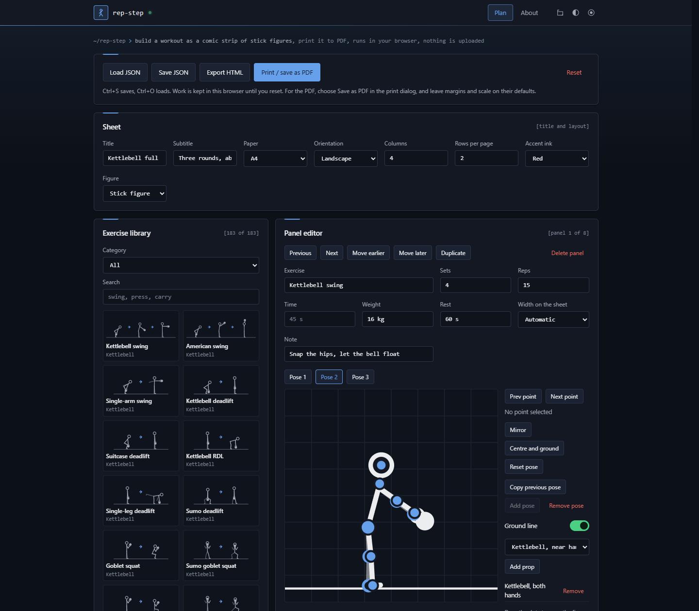
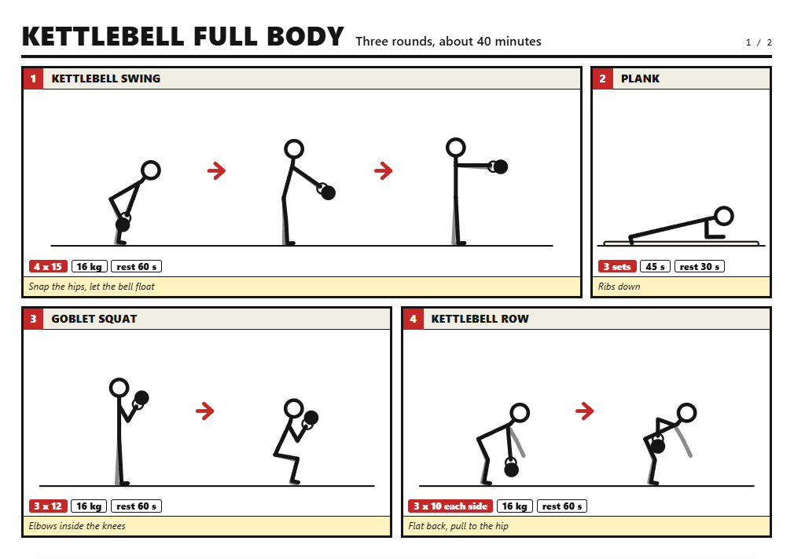
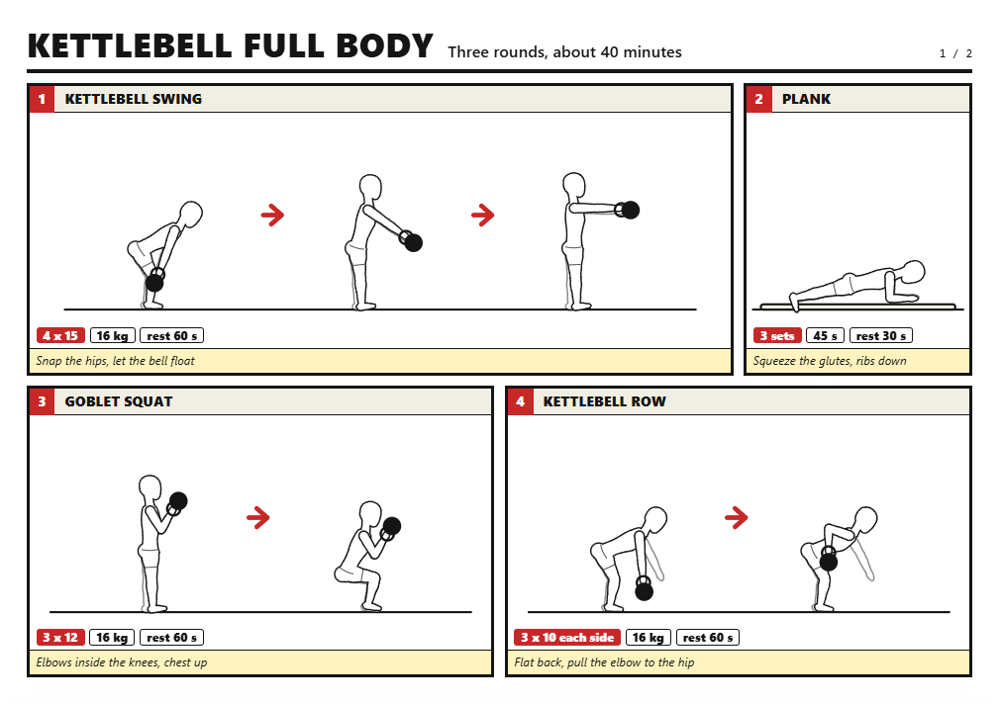
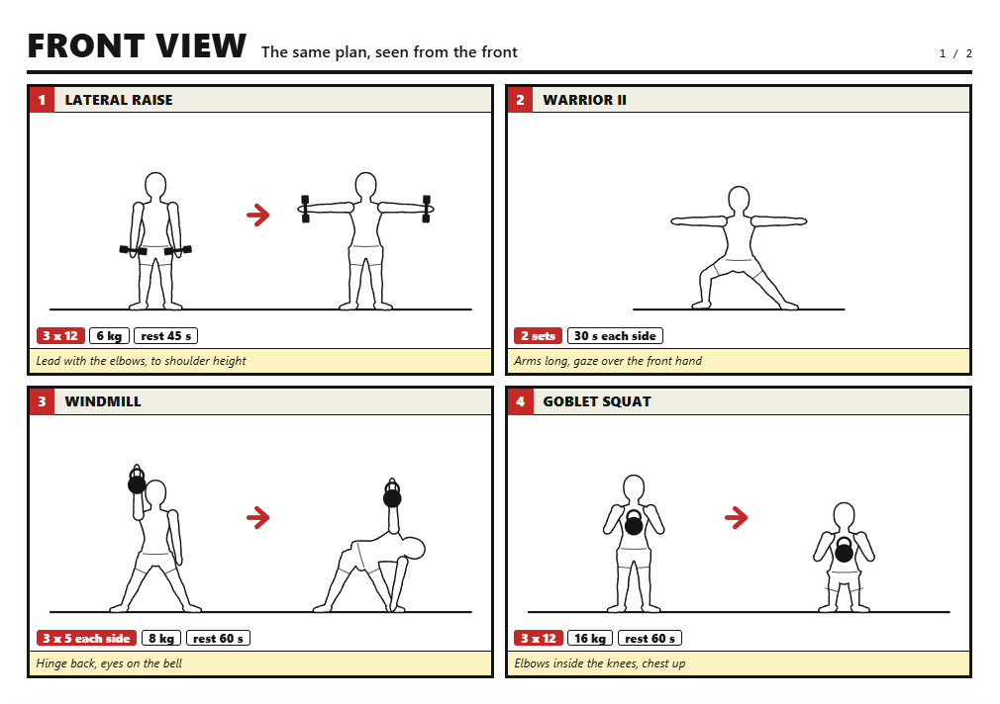
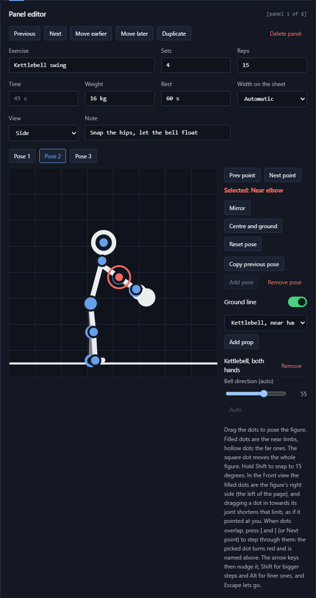
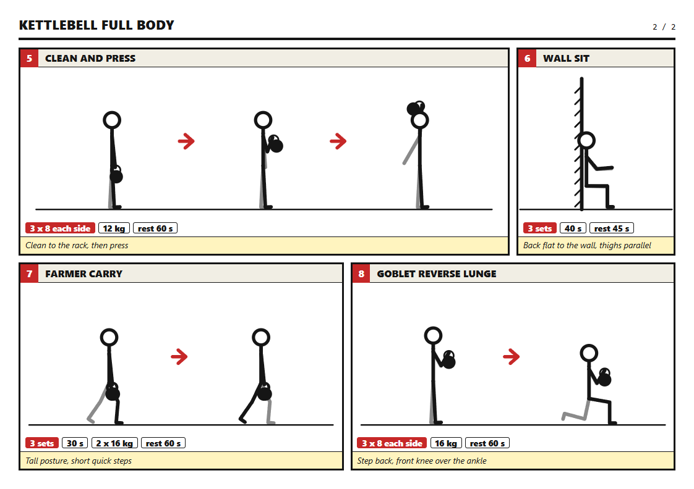
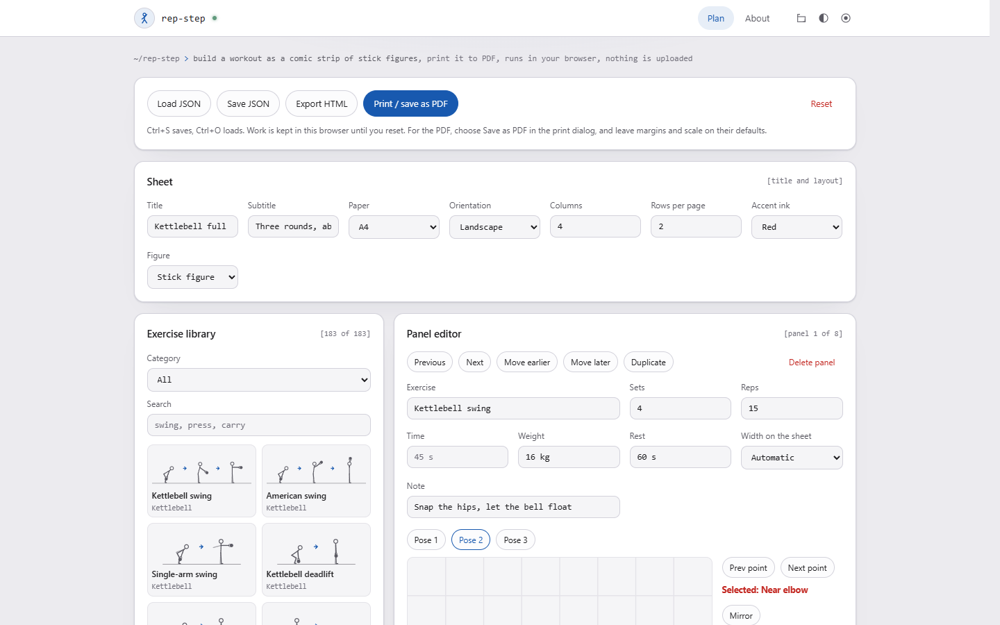

# rep-step

Build a workout as a comic strip of stick figures and print it to PDF for the wall. One file, no build step, no dependencies, no network calls. Open `index.html` and it works, including from `file://`.

Each panel is one exercise with one, two or three poses side by side, plus sets, reps, time, weight, rest and a note. Panels flow across the page like a comic, and a panel with 2 or 3 poses takes 2 or 3 columns.

The sheet that prints, page 1 of a two page plan (A4 landscape, four columns, two rows):

## Using it

1. Pick an exercise from the library to add a panel, or add a blank one.
2. Select a panel (click it in the preview) and edit its text, poses and props.
3. Set paper, orientation, columns and rows per page (up to 6), and the figure style, in the Sheet panel. Change a panel's width in the panel editor to make a row fit.
4. Print, and choose Save as PDF as the destination.

## Figures

The Figure setting in the Sheet panel switches the whole plan between two styles. **Stick figure** is the default. **Outline** draws a faceless mannequin in shorts around the same skeleton, so every preset and every pose you have made works in both without any change. The choice is saved with the plan.

The library thumbnails and the pose editor always show sticks, so the drag dots sit on the bones. The outline is for the sheet and the print.

## Front view

Every panel has a View setting in the panel editor, Side or Front, and it works with both figure styles. Plenty of moves only make sense face on (lateral raise, jumping jack, warrior II, windmill), so a panel starts in Front when the exercise is one of those: lateral raise, jumping jack, side lunge, goblet lateral lunge, sumo squat, sumo goblet squat, windmill, side swing, arm circles, side stretch, tree pose, warrior II, triangle and extended side angle. Everything else starts in Side, and you can switch any panel either way.

The front view is a second, flat skeleton. Its angles run from straight down and are positive outward from the midline, so the same number works for both sides, and a limb that points at you is drawn shorter. The figure's right side is on the left of the page, as it would be facing you. You do not have to pose anything to use it: a front pose is worked out from the side pose, with the same heights, so props and the ground line still line up. Where that is not enough, an exercise carries a hand-set front pose (the wide stances, the arms out to the side, the leaning torsos). Floor exercises are drawn from above, with the head at the top of the cell, the mat behind them and no ground line.

In the pose editor the Front view has its own dots, and dragging one in towards its joint shortens the limb, as if it were pointing at you. Mirror swaps the right and left sides (and the hand a kettlebell is in), Centre and ground works out the position again and Reset pose goes back to a plain standing figure. Editing the front pose never changes the side pose, or the other way round. The first edit of a front pose stores it with the panel as `fv`, and a panel stores its `view`.

## Posing

Poses are stored as joint angles on a skeleton with fixed bone lengths, so every figure is the same person. Drag a dot to turn that bone around its parent. Everything below it keeps its own angle, so pulling an elbow carries the hand with it.

| Control | Does |
|---|---|
| Filled dots | Near limbs, head and neck |
| Hollow dots | Far limbs, drawn lighter on the sheet |
| Square dot | Moves the whole figure |
| Shift while dragging | Snaps to 15 degrees |
| Next point, Prev point (or `]` and `[`) | Steps through the dots one at a time, for when they overlap. The picked dot turns red and is named beside the button, props included |
| Arrow keys | Move the picked dot by 1 unit. Shift moves 4, Alt moves a quarter. A bone only turns, so a dot on it moves around its parent. Escape lets go. Ignored while you type in a field |
| Mirror | Flips the pose to face the other way (in the Front view it swaps right and left) |
| Centre and ground | Rests the lowest point on the ground line and centres the figure |
| Copy previous pose | Starts this pose from the one before it |

Props: kettlebell, dumbbell, barbell (front or side view), medicine ball, bench, box, pull-up bar, wall and mat, plus a rowing machine, an exercise bike and a skipping rope (overhead or under the feet). Held props follow the hand. A kettlebell also has a Bell direction slider, in whichever view is showing: 0 hangs the bell below the hands (a goblet hold), 90 points it forward, 180 puts it above the hands, and Auto lets it follow the forearm. The library uses it to hold the bell as it is really held: hanging for goblet work, on the forearm for the rack, behind the fist overhead. Scenery props have a dot you can drag. The machines and the rope have no dot: they are drawn from the figure's hips, hands and feet, so they stay attached when you edit the pose.

## PDF

The PDF comes from the browser's own print, so it is vector and stays sharp at A3. The page size and orientation are written into `@page` from the Sheet settings, and the margin is zero, so the browser adds no header or footer. If the coloured chips come out blank, turn on background graphics in the print dialog. The sheet is always dark ink on white, whatever design and mode the tool itself is in.

## Appearance

Four designs (cobalt, chamfer, console, contour), four modes (dark, dusk, sepia, light) and any accent colour, chosen from the buttons at the top right. The sheet ignores all of this and always prints dark ink on white.

## Saving

Export HTML writes the sheets as one standalone page: no script, no network and no dependencies, with a strict meta CSP of its own. It uses the same markup and the same CSS rules as the preview (the CSS comes from the `sheetCss` block in this file), in whichever figure style is selected, so it looks the same and prints to PDF the same way. Titles and notes are escaped by the serialiser, not by hand.

Save JSON writes the whole plan, including each panel's view, any hand-edited front poses and the direction of each bell. Load JSON reads it back, including files saved under the old name `rep-strip`. The plan is also autosaved to this browser. Everything read from a file or from storage is rebuilt field by field through `cleanState()`, so unknown keys are dropped, numbers are clamped and only known props are accepted.

## Layout

Panels are placed left to right. A panel takes one column per pose unless you set its Width on the sheet in the panel editor: Automatic is one column per pose, and 1 to 6 columns fixes the width (never more than the sheet has). A narrow panel is how you fit four short exercises across a landscape page, and a wide one is how you fill a row. If the next panel will not fit in the row, the previous one stretches to close it. A partly filled last row is left open. `rows` is how many rows fit on a page, up to 6, and extra rows go onto further pages. Type scales with paper size, so A3 is A4 enlarged. In the five and six row modes it also scales down when the rows get short (landscape, or six rows), by the same amount on every panel so they stay uniform. Four rows or fewer are always full size. The reps, weight and rest chips are as tall as one line of note in every layout.

## Library

183 starter exercises in twelve categories: Kettlebell (49, including double-bell work, carries, Turkish get-up, snatch, windmill, halo, seated halo, two-hand overhead press, around the world, side swing and wood chop), Dumbbell (16, with skull crusher, renegade row, thruster and a bench row), Barbell (10, with back and front squat, hip thrust, good morning and hang clean), Legs (18, with pistol squat, Nordic curl, Bulgarian split squat and lunge to knee drive), Push (5, with pike, decline and bench dips), Pull (5, with inverted row and dead hang), Core (17, with dead bug, reverse crunch, bridge march and plank up-down), Pilates (9: hundred, roll-up, single-leg and double-leg stretch, rolling like a ball, swimming, both leg pulls and the side-lying leg lift), Cardio (16, with running, jump rope, spinning, the rowing machine, bear crawl, medicine ball slam and wall ball), Stretch (12, including half splits and a biceps wall stretch), Yoga (17: warriors I to III, triangle, extended side angle, upward and downward dog, dolphin, puppy, sphinx, child's pose, reverse tabletop, legs up the wall and a vinyasa flow) and Mobility (9: thread the needle, world's greatest stretch, the knee-to-wall ankle drill, couch stretch, walking knee hug and wall hip hinge). Every one comes with a short coaching cue as its default note, so a freshly added panel is never blank. Filter by category or search by name. They live in `LIB_SRC` as plain angle objects, and `buildLib()` grounds and centres each one. To add an exercise, copy an entry and change the angles. Front-view data (the default view, hand-set front poses, which floor exercises are drawn from above, and bell directions) lives apart from the side poses, in the `FRONT` table, keyed by exercise id. Poses are approximations, so expect to nudge some in the editor. The least convincing are the floor and curled poses (child's pose, sit-up, hollow and V-sit holds, knees to chest, single-leg stretch, rolling like a ball, thread the needle), side plank, step-up and the couch stretch. The torso is a single rigid bone, so anything that needs a curved spine or a twist (cat-cow, seated twists, a true wheel) is not in the library.

## Known gaps

- Figures are flat 2D. The side view and the front view are two separate skeletons, not one body in 3D, so the front view of an exercise that nobody has hand-set is the side pose projected: heights are right, but there is no sideways movement, and a pose that is half turned cannot be drawn. The outline figure has no face.
- The torso is one rigid bone, so poses that bend or twist the spine (cat-cow, spinal twists) cannot be drawn. A kettlebell sits in line with the forearm unless you set its direction, and the library does for the holds where that matters.
- The machines (rowing machine, bike) and the skipping rope are simple sketches in the Front view.
- There is no undo. Reset pose and Copy previous pose are the way back.

## Security

Same baseline as the template: strict meta CSP, `no-referrer`, `noindex`, no remote fonts or scripts, and CI that checks it stays that way. Nothing is assigned through `innerHTML`; all text goes in with `textContent` and all SVG is built with `createElementNS`. The CSP in `index.html`, `_headers` and `.htaccess` is unchanged from the template.

## Licence

MIT. See `LICENSE`.
